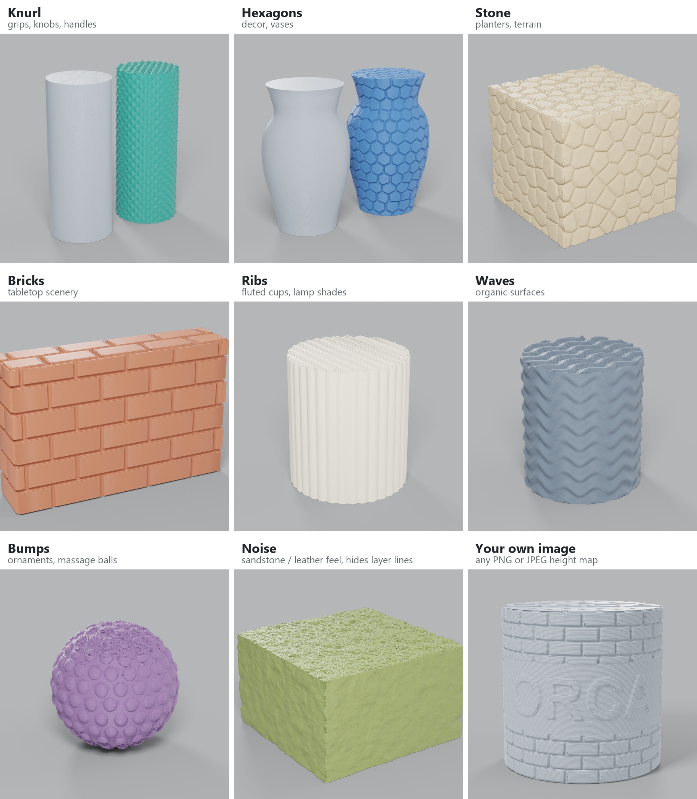
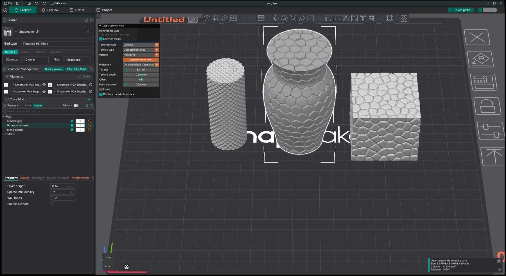

# Snapmaker Orca with displacement maps

This is a fork of [Snapmaker Orca](https://github.com/Snapmaker/OrcaSlicer). It adds **displacement maps**: a real surface texture
from a built-in pattern, your own image, a model's normal map or a generated texture from a text description. The texture is applied while slicing. The mesh
is never subdivided, so a 640-triangle cylinder can print a 0.4 mm knurl and the project stays a few kilobytes.

The work is on the branch [`displacement-maps`](https://github.com/dlvkz/OrcaSlicer/tree/displacement-maps),
which starts from Snapmaker Orca `main` (fd6e55e). This fork is not made or supported by Snapmaker. It has been built and tested on
Windows only.



## What it adds

**In the settings** (Process → Others → **Surface texture**, set **Texture type** to **Displacement map**; or the **Displacement map**
panel at the top left of the 3D view):

- **Patterns**, no image needed: knurl, hexagons, bricks, ribs, waves, bumps, stone and noise. All tile seamlessly.
- **Your own image**: PNG (8 or 16 bit, grey or colour) or JPEG. White pushes the surface out, black pulls it in.
- **Generate from text**: describe a surface ("tree bark", "cobblestone pavement") and pick one of the seamless height maps it
  makes. It runs locally with no upload, on your graphics card (Vulkan) or else on the processor. The model is an optional add-on
  (about 0.93 GB) that the app downloads the first time you use it.
- **Projections**: box (triplanar), cylindrical, spherical, planar (top, front, side), UV and **on the surface**.
  - **UV** uses the model's own texture coordinates. When the part was loaded from a GLB, glTF or OBJ file, that file is used
    automatically.
  - **On the surface** lays the pattern out on the mesh itself instead of projecting a flat image. Honeycomb, bumps, stone and noise
    are built as cells on the surface. Images and stripes are laid down in small overlapping patches along the surface.
- **Tile size, rotation, invert and offset.** The offset works like Blender's midlevel: 0 cuts the texture into the surface, 1 raises
  it out of the surface, and 0.5 goes both ways.
- **Whole surface or per layer.** By default the texture goes on the shape itself, so tops, slopes and overhang undersides get it
  too. "Per layer only" just moves each layer's outline sideways. That is faster, about as fast as ordinary fuzzy skin, and leaves
  tops flat.
- **Per object.** Each object can have its own texture. Select it, and the panel edits that object only.
- **Normal map to relief.** When a GLB, glTF or OBJ model with a normal map is loaded, the slicer offers to turn the normal map into
  a 16-bit height map and print it as relief through the model's UVs. This is also on the right-click menu and on the command line
  (`--relief-from-normal-map`).

**In the 3D view:**

- **Live preview before slicing.** The model is displaced on the GPU by tessellation (OpenGL 4.0), so no high-polygon copy is made
  and sliders update as you drag. On older OpenGL the texture is only shaded.
- The **Displacement map** panel is always visible in this fork, out of convenience.

**Slicing fixes and helpers that came out of this work:**

- **Supports ignore the texture** (optional): tree supports are planned from the untextured shape, so they don't chase every bump.
  Tree-support overhang detection is also faster.
- **Open surface thickness** (Quality → Precision): prints zero-thickness sheets and paper-thin parts (capes, flags, leaves on
  AI-generated models) as bands of the given width instead of dropping them.
- **Deterministic slicing of broken meshes**: the same project now gives the same layers every time. Before, layers of meshes with
  holes or non-manifold edges could differ from run to run.



## Quick start

1. Select an object. In the **Displacement map** panel, press **Use a displacement map**.
2. Pick a **Pattern**, or **Image** and a file, or **Generate from text…**.
3. Pick a **Projection** and a **Tile size**, then set the **Texture depth**. 0.3 to 0.6 mm reads well with a 0.4 mm nozzle.
4. Slice.

The full reference is in the [Surface texture / fuzzy skin page](doc/print_settings/others/others_settings_fuzzy_skin.md#displacement-map).

## Measured

A Ø40 × 40 mm cylinder with a PNG texture, sliced for the Snapmaker U1 with the same profile (slice time is the median of 3 runs):

| | Project size | Slice time |
|---|---|---|
| 512-triangle cylinder + displacement map, whole surface | **0.022 MB** | 1.78 s |
| same, per layer only | **0.022 MB** | **1.53 s** |
| the same texture baked into a 1.26 M-triangle mesh | 15.1 MB | 4.95 s |

The printed outer walls of the map and the baked mesh match to a median of 4.3 µm (95% of points within 26 µm).

A map only saves space and time against heavy meshes. A model that is already light (tens of thousands of triangles) plus a 2048 ×
2048 16-bit map is bigger and slower to slice than the model on its own.

## Known limits

- A flat image can't wrap a closed shape without a seam or stretching somewhere. **On the surface** avoids that, but where its
  patches meet you can see a soft band, and on spheres some doubled lines.
- glTF files with compressed geometry (EXT_meshopt, Draco) are refused with a clear message. `scripts/glb_unmeshopt.py` converts
  meshopt files.
- Fine, deep textures add print time.
- Tested on Windows only.

## Licence and credits

AGPL-3.0, like Snapmaker Orca and OrcaSlicer. Generate from text is powered by Stability AI: SD-Turbo is used under the Stability AI
Community License, with a copy and a NOTICE in the model folder. Normal maps from colour come from DeepBump by Hugo Tini (GPL-3.0),
and fast decoding from TAESD by Ollin Boer Bohan (MIT).

The original Snapmaker Orca README follows.

---

<h1> <p "font-size:200px;"> Snapmaker Orca</p> </h1>

[](https://github.com/Snapmaker/OrcaSlicer/actions/workflows/build_all.yml)
<br>Snapmaker Orca is an open source slicer for FDM printers based on OrcaSlicer.
 


# Download

### Stable Release
📥 **[Download the Latest Stable Release](https://github.com/Snapmaker/OrcaSlicer/releases/latest)**  
Visit our GitHub Releases page for the latest stable version of Snapmaker Slicer, recommended for most users.

# How to install
**Windows**: 
1.  Download the installer for your preferred version from the [releases page](https://github.com/Snapmaker/OrcaSlicer/releases).
    - *For convenience there is also a portable build available.*
    - *If you have troubles to run the build, you might need to install following runtimes:*
      - [MicrosoftEdgeWebView2RuntimeInstallerX64](https://github.com/SoftFever/OrcaSlicer/releases/download/v1.0.10-sf2/MicrosoftEdgeWebView2RuntimeInstallerX64.exe)
          - [Details of this runtime](https://aka.ms/webview2)
          - [Alternative Download Link Hosted by Microsoft](https://go.microsoft.com/fwlink/p/?LinkId=2124703)
      - [vcredist2019_x64](https://github.com/SoftFever/OrcaSlicer/releases/download/v1.0.10-sf2/vcredist2019_x64.exe)
          -  [Alternative Download Link Hosted by Microsoft](https://aka.ms/vs/17/release/vc_redist.x64.exe)
          -  This file may already be available on your computer if you've installed visual studio.  Check the following location: `%VCINSTALLDIR%Redist\MSVC\v142`

**Mac**:
1. Download the DMG for your computer: `arm64` version for Apple Silicon and `x86_64` for Intel CPU.  
2. Drag Snapmaker_Orca.app to Application folder. 
3. *If you want to run a build from a PR, you also need to follow the instructions below:*  
    <details quarantine>
    - Option 1 (You only need to do this once. After that the app can be opened normally.):
      - Step 1: Hold _cmd_ and right click the app, from the context menu choose **Open**.
      - Step 2: A warning window will pop up, click _Open_  
      
    - Option 2:  
      Execute this command in terminal: `xattr -dr com.apple.quarantine /Applications/Snapmaker_Orca.app`
      ```console
          softfever@mac:~$ xattr -dr com.apple.quarantine /Applications/Snapmaker_Orca.app
      ```
    - Option 3:  
        - Step 1: open the app, a warning window will pop up  
              
        - Step 2: in `System Settings` -> `Privacy & Security`, click `Open Anyway`:  
              
    </details>
    
**Linux (Ubuntu)**:
 1. If you run into trouble executing it, try this command in the terminal:  
    `chmod +x /path_to_appimage/Snapmaker_Orca_Linux.AppImage`
    
# How to compile
- Windows 64-bit  
  - Tools needed: Visual Studio 2019, Cmake, git, git-lfs, Strawberry Perl.
      - You will require cmake version 3.14 or later, which is available [on their website](https://cmake.org/download/).
      - Strawberry Perl is [available on their GitHub repository](https://github.com/StrawberryPerl/Perl-Dist-Strawberry/releases/).
  - Run `build_release.bat` in `x64 Native Tools Command Prompt for VS 2019`
  - Note: Don't forget to run `git lfs pull` after cloning the repository to download tools on Windows

- Mac 64-bit  
  - Tools needed: Xcode, Cmake, git, gettext, libtool, automake, autoconf, texinfo
      - You can install most of them by running `brew install cmake gettext libtool automake autoconf texinfo`
  - run `build_release_macos.sh`
  - To build and debug in Xcode:
      - run `Xcode.app`
      - open ``build_`arch`/Snapmaker_Orca.Xcodeproj``
      - menu bar: Product => Scheme => Snapmaker_Orca
      - menu bar: Product => Scheme => Edit Scheme...
          - Run => Info tab => Build Configuration: `RelWithDebInfo`
          - Run => Options tab => Document Versions: uncheck `Allow debugging when browsing versions`
      - menu bar: Product => Run

- Ubuntu 
  - Dependencies **Will be auto-installed with the shell script**: `libmspack-dev libgstreamerd-3-dev libsecret-1-dev libwebkit2gtk-4.0-dev libosmesa6-dev libssl-dev libcurl4-openssl-dev eglexternalplatform-dev libudev-dev libdbus-1-dev extra-cmake-modules libgtk2.0-dev libglew-dev libudev-dev libdbus-1-dev cmake git texinfo`
  - run 'sudo ./BuildLinux.sh -u'
  - run './BuildLinux.sh -dsir'


# Note: 
If you're running Klipper, it's recommended to add the following configuration to your `printer.cfg` file.
```
# Enable object exclusion
[exclude_object]

# Enable arcs support
[gcode_arcs]
resolution: 0.1
```


## Some background
Snapmaker Orca is originally forked from Snapmaker_Orca.

Snapmaker_Orca is originally forked from Bambu Studio, it was previously known as BambuStudio-SoftFever.
Bambu Studio is forked from [PrusaSlicer](https://github.com/prusa3d/PrusaSlicer) by Prusa Research, which is from [Slic3r](https://github.com/Slic3r/Slic3r) by Alessandro Ranellucci and the RepRap community. 
Orca Slicer incorporates a lot of features from SuperSlicer by @supermerill
Orca Slicer's logo is designed by community member Justin Levine(@freejstnalxndr)  


# License
Snapmaker Orca is licensed under the GNU Affero General Public License, version 3. Snapmaker_Orca is based on Orca Slicer by SoftFever

Orca Slicer is licensed under the GNU Affero General Public License, version 3. Orca Slicer is based on Bambu Studio by BambuLab.

Bambu Studio is licensed under the GNU Affero General Public License, version 3. Bambu Studio is based on PrusaSlicer by PrusaResearch.

PrusaSlicer is licensed under the GNU Affero General Public License, version 3. PrusaSlicer is owned by Prusa Research. PrusaSlicer is originally based on Slic3r by Alessandro Ranellucci.

Slic3r is licensed under the GNU Affero General Public License, version 3. Slic3r was created by Alessandro Ranellucci with the help of many other contributors.

The GNU Affero General Public License, version 3 ensures that if you use any part of this software in any way (even behind a web server), your software must be released under the same license.

Orca Slicer includes a pressure advance calibration pattern test adapted from Andrew Ellis' generator, which is licensed under GNU General Public License, version 3. Ellis' generator is itself adapted from a generator developed by Sineos for Marlin, which is licensed under GNU General Public License, version 3.

The Bambu networking plugin is based on non-free libraries from BambuLab. It is optional to the Orca Slicer and provides extended functionalities for Bambulab printer users.

# Feedback & Contribution
We greatly value feedback and contributions from our users. Your feedback will help us to further develop Snapmaker Orca for our community.
- To submit a bug or feature request, file an issue in GitHub Issues or email us at support@snapmaker.com.
- To contribute some code, make sure you have read and followed our guidelines for contributing.
